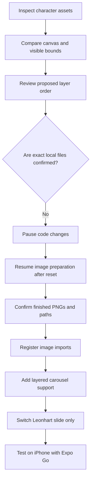

# Day 12 — Leonhart Layer Planning & AI Workflow Bottlenecks

> **Date:** 17 November 2026  
> **Project:** System: T-0  
> **Focus:** Modular character customization, asset inspection and AI-assisted workflow  
> **Status:** Planning documented; implementation pending

## 1. Today's Summary

Today focused on planning the first modular Leonhart character preview. The aim is to move from one flattened character image to separate transparent layers: a base body, face and hairstyle.

The image-inspection report shared today states that the selected Leonhart base, male face and red hair images all use a **1199 × 1312 px** canvas. A preliminary composite (base → face → hair) appeared aligned. This is promising, but it has not yet been tested inside the app.

No application code was changed, no image assets were overwritten, and no Expo Go test was completed. We paused deliberately until the exact local files are confirmed and the remaining raw face/hair assets can be prepared.

## 2. Image Inspection Findings

| Layer | Canvas | Reported visible bounds | Notes |
|---|---:|---|---|
| Leonhart base | 1199 × 1312 | Head area: x 442–739, y 302–599 | Transparent base with hair/face removed |
| Male face | 1199 × 1312 | x 453–760, y 309–527 | Black edge specks; chin may overlap collar |
| Red hair | 1199 × 1312 | x 388–811, y 125–417 | Some pixels reported at 80–99% opacity |

These are reported inspection findings, not independently repeated measurements or an in-app verification.

### Intended layer order

```text
Leonhart_Base.png
       ↓
Male_Face_1.png
       ↓
Red Hair.png
       ↓
Layered Leonhart preview
```

## 3. Proposed Code Work — Not Yet Applied

| File | Planned change | Status |
|---|---|---|
| `assets/profileImages.js` | Register base, face and red-hair image imports | Pending |
| `src/components/AvatarCarousel.js` | Support layered slides while preserving ordinary images and placeholders | Pending |
| `src/screens/ProfileScreen.js` | Use the three layers for Leonhart only | Pending |

Emilia, Coming Soon, the Edit Name modal, gender selection, carousel controls, stats and other working UI must remain unchanged. Keep the old flat Leonhart image as a rollback option. No new package is currently expected.

Illustrative rendering concept only — this is **not code added to the app**:

```jsx
<View>
  <Image source={baseImage} />
  <Image source={faceImage} />
  <Image source={hairImage} />
</View>
```

All layers must share the same display frame so they scale together.

## 4. Tools, Languages and Stack

| Tool / technology | Role | Today's status |
|---|---|---|
| Claude 1 | Image preparation and asset alignment | Free-message limit reached; reset shown as 2:30 AM |
| Claude 2 | Inspected three images and four code files; proposed a three-file implementation | Plan received; no code changed |
| ChatGPT | Technical consultation, planning, review and documentation | Used |
| Cursor | Local editor for manually applying reviewed code | No code pasted today |
| Expo / Expo Go | App development and iPhone preview | Existing stack; no device test today |
| React Native | Mobile UI framework | Existing project technology |
| Expo Router | Navigation foundation | Existing project technology |
| JavaScript / JSX | App language and component syntax | Existing project technology; no new implementation |
| Markdown | Development log | Used today |

The local app was previously reported as using Expo SDK 58 and React Native 0.88.1; verify the local `package.json` before relying on exact versions. The GitHub repository is currently a documentation/devlog repository; the full app source and asset library are not tracked there.

## 5. Main Challenge: AI Usage Limits

The biggest frustration today was the interruption caused by AI message limits. The workflow currently uses Claude for coding and image-preparation assistance, ChatGPT for consultation and technical review, and Cursor as the local editor where changes are manually applied.

This division of work is useful, but it creates a bottleneck: when Claude's free-message allowance runs out, development can stop even when the next step is already clear. Claude 1 displayed a message saying free messages would resume at **2:30 AM the following day**. Claude 2 also reached its limit after returning its inspection and plan.

It is genuinely discouraging to prepare a task, reach the point where work can move forward, and then be blocked by a usage limit. The problem is not simply inconvenience; it interrupts concentration and makes development progress unpredictable.

### Lessons and possible improvements

1. Avoid depending on a single AI account for every development step.
2. Keep prompts focused and avoid repeatedly sending the entire project history.
3. Maintain a reusable project handover note with current paths, decisions and pending work.
4. Ask for inspection first, then request one small code change at a time.
5. Save useful decisions and code explanations outside individual chats.
6. Compare sustainable AI coding options and costs before committing to a subscription.

No new subscription or alternative coding service was selected today.

## 6. Today's Workflow



## 7. End-of-Day Progress Snapshot

| Workstream | Status | Next action |
|---|---|---|
| Base, face and red-hair inspection | Reported complete | Confirm local file identity |
| Remaining male face and hair variations | Waiting | Upload original files in batches |
| Layered character code | Not started | Begin after assets are confirmed |
| Emilia customization | Deferred | Revisit after Leonhart proof of concept |
| Clothes and weapons | Deferred | Keep outside first milestone |
| Expo Go validation | Pending | Test after incremental code edits |
| AI-tool reliability | Bottleneck identified | Investigate a sustainable fallback |

## 8. What Went Well

- The first three layers reportedly share one canvas size.
- The proposed code change is limited to three existing files.
- The first test has a clear scope: Leonhart, one face and one hairstyle.
- We avoided rushing code changes while file identity remains uncertain.

## 9. What Did Not Go Well

- AI message limits interrupted the work more than once.
- Image preparation must wait until an assistant is available.
- Exact local file identity and paths still need confirmation.
- There is not yet a layered character running in the app.

## 10. Next Session — Day 13

1. Continue with Claude 1 after its limit resets.
2. Upload original male face and hair assets in batches of about six.
3. Align selected assets to the 1199 × 1312 transparent template without redesigning the pixel art.
4. Keep original files as backups and inspect returned PNGs.
5. Confirm exact filenames and local paths.
6. Register the first three images in `assets/profileImages.js`.
7. Test each small code change before proceeding to the next file.
8. Verify the layered Leonhart preview on the iPhone through Expo Go.

## 11. Final Reflection

Today was not a coding milestone, and it would be misleading to describe it as one. It was a day of measuring, checking assumptions, choosing a safer implementation path and confronting a weakness in the development workflow.

The most frustrating part was being ready to continue but repeatedly running into usage limits. AI assistance is helping me build System: T-0, but I need a workflow that remains dependable when one tool becomes unavailable. Tomorrow's goal is to finish preparing the first Leonhart layers, then return to the app one small change at a time.

**Day 12 outcome:** The first layered-character plan is documented. Asset confirmation, code integration and device validation remain pending.

---
*System: T-0 — Development log*
