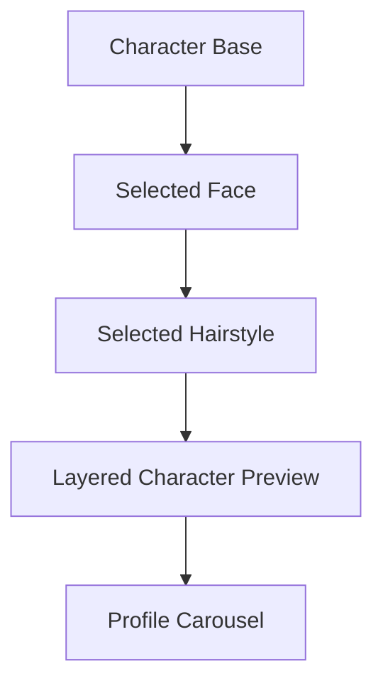

# Day 13 — Male & Female Character Asset Preparation

**Project:** System: T-0  
**Date:** 18 November 2026  
**Focus:** Character bases, face and hair assets, transparency, and alignment

## Daily Summary

Today I focused on preparing both male and female characters for modular customization. I finished preparing the male face and hair assets, then completed the female face and hair preparation as well. I also created a bald base for Mia, the second female character.

The work included removing backgrounds, making the assets transparent, creating clean bald face layers, and carefully matching the size and position of faces and hairstyles with their character bases. This was a detailed, mostly manual process because even small alignment errors can make the character look unnatural in the app.

## Progress Overview

| Work area | Day 13 result | Status |
|---|---|---|
| Male character base | Clean base prepared | Ready |
| Male faces | Face assets prepared and aligned | Ready |
| Male hairstyles | Three hairstyle variations prepared and aligned | Ready |
| Female character base | Base prepared for modular layers | Ready |
| Female faces | Face assets prepared and aligned | Ready |
| Female hairstyles | Hair assets prepared and aligned | Ready |
| Mia (second female character) | Base character prepared | Ready |
| Transparency | Backgrounds removed; transparent assets prepared | Ready |
| Layer alignment | Face and hair positions matched to their bases | Ready |
| App integration | Final connection and device testing still pending | Next |

## Technical Workflow

### Asset preparation

- Used **Photopea** to remove backgrounds and refine transparent PNG assets.
- Prepared bald face layers so hairstyles can be placed independently.
- Kept the character canvas and layer positions consistent to support accurate stacking.
- Checked the face and hair placement against the corresponding character bases.

### Existing app code involved in the customization flow

| File | Responsibility |
|---|---|
| `assets/profileImages.js` | Registers image assets used by the app |
| `assets/characterLayers.js` | Stores character layer mappings |
| `src/components/LayeredCharacter.js` | Renders the character using stacked image layers |
| `src/components/AvatarCarousel.js` | Displays character slides in the Profile carousel |
| `src/components/PartPickerModal.js` | Displays face and hair selection options |
| `src/screens/ProfileScreen.js` | Connects the character preview and customization controls |

**Code status:** Day 13 was mainly an asset-preparation day. The existing layered-character code provides the integration path, but today's newly prepared female assets still need to be registered, connected, and tested in the app. No new code changes are claimed in this log.

## Character Layer Structure

The intended rendering order is:

The face and hair selectors should update only their own layer while keeping the other selected layer unchanged.

## Quality Checks Before Integration

- Keep each base, face, and hairstyle on the correct matching canvas.
- Preserve genuine alpha transparency; avoid black or checkerboard pixels baked into the background.
- Preserve the original pixel-art outlines, colors, and proportions.
- Confirm that the face covers the bald head cleanly and the hairstyle sits naturally above it.
- Test the result on the iPhone through Expo Go before expanding customization.

## Next Steps

1. Register the final male and female assets in the app's asset mapping.
2. Set default face and hairstyle selections for both characters.
3. Connect the female assets to the layered-character preview.
4. Test all available face and hair choices on the Profile screen.
5. Fix any alignment, overlap, or transparency issues before moving on to clothes and weapons.

## Day 13 Outcome

**Male and female face and hair assets are prepared. Mia's base is also ready. The next milestone is connecting the prepared assets to the existing customization code and testing both characters in the app.**
