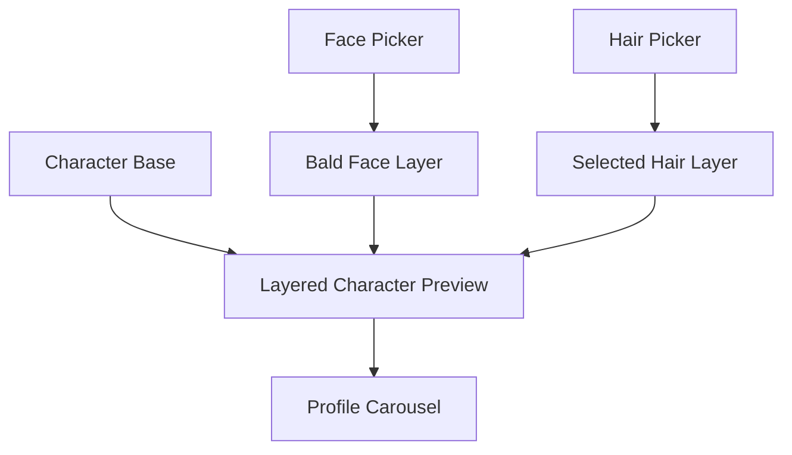

# Day 14 — Character Asset Preparation: Male & Female

**Date:** 18 November 2026  
**Project:** System: T-0  
**Focus:** Preparing modular character assets for the profile customization system

## Executive Summary

Today was focused on completing the visual assets needed for modular character customization. The male and female character sets were prepared separately, with transparent base images, bald face layers, and multiple hairstyles aligned to their character canvases. The second female character, Mia, also received a prepared base. This moves the project closer to supporting interchangeable face and hair layers without relying on one flattened character image.

## Work Completed

| Area | Work completed | Status |
|---|---|---|
| Male character | Prepared the bald base, face assets, and hairstyle variations | Complete |
| Male hairstyles | Removed backgrounds and aligned the hair layers to the character canvas | Complete |
| Female character | Prepared the bald base and face assets | Complete |
| Female hairstyles | Removed backgrounds and aligned hairstyle layers | Complete |
| Second female character (Mia) | Prepared the character base | Complete |
| Asset consistency | Worked toward matching canvas size, transparency, and layer positioning | Complete; device validation remains important |

## Technical Workflow

The asset workflow was carried out using **Photopea** for image editing:

1. Removed unwanted backgrounds to create transparent PNG assets.
2. Removed the original hair from face layers to create clean bald-face layers.
3. Kept the character body, armor, clothes, sword, and shield in separate base artwork.
4. Adjusted face and hair placement so the layers align with their character base.
5. Kept the assets organized for use in the app.

### App integration points

The existing React Native / Expo customization implementation is intended to consume these assets through:

| File / component | Responsibility |
|---|---|
| `assets/profileImages.js` | Register local image assets using static `require()` paths |
| `assets/characterLayers.js` | Keep character layer and variation definitions |
| `src/components/LayeredCharacter.js` | Render base, face, and hair as stacked image layers |
| `src/components/AvatarCarousel.js` | Display the character inside the profile carousel |
| `src/components/PartPickerModal.js` | Show face and hairstyle choices |
| `src/screens/ProfileScreen.js` | Manage the selected character and customization state |

**Technical note:** Expo / React Native supports local image assets through static `require()` references. Exact file paths and names must match the files on disk. [Expo Assets documentation](https://docs.expo.dev/develop/user-interface/assets/)

## Layer Structure

## Outcome

- Male face and hair assets are prepared.
- Female face and hair assets are prepared.
- Mia's base image is prepared.
- Face and hair layers are aligned for the next integration and testing stage.
- The asset preparation work is ready to move into a broader app test.

## Pending Validation

- Test all male face and hair combinations in the running app.
- Test all female face and hair combinations.
- Check the final appearance on the iPhone, especially hairline coverage, face placement, and edges.
- Confirm that changing one layer does not reset the other.
- Keep clothes and weapons as future customization layers.

## Next Step

Integrate and validate the completed male and female asset sets in the existing customization flow. Test one character at a time and avoid changing unrelated profile features.

---

**Day 14 takeaway:** Today was about building the visual foundation properly. The character assets are now prepared as separate pieces, making the next stage—reliable in-app customization—much more achievable.
