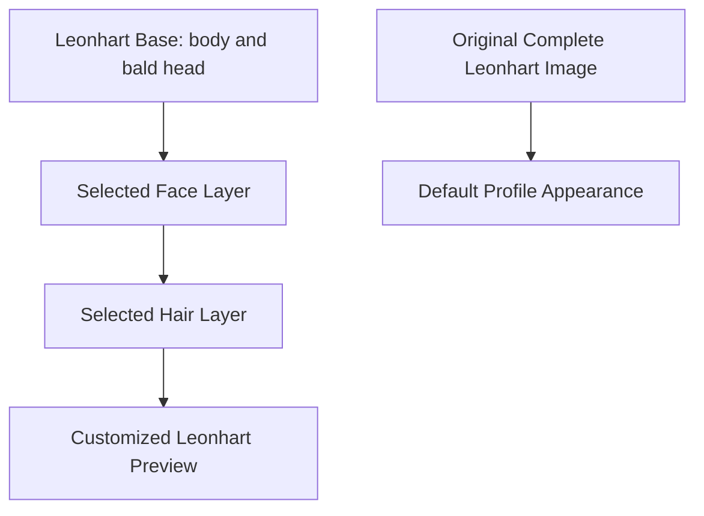
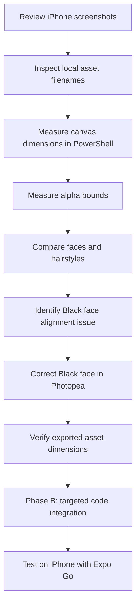

# Day 14 — Character Customization Asset Diagnosis & Alignment

**Project:** System: T-0  
**Date:** 19 November 2026  
**Focus:** Male character customization — asset inspection, face alignment, and preparation for code integration  
**Status:** Phase A asset diagnosis completed; Phase B code integration pending

---

## 1. Daily Summary

Today’s work focused on diagnosing visual problems in the male character customization system of **System: T-0**, a gamified productivity and daily-planning app with a character-based profile experience.

The Hair and Face selection popups were already opening and displaying their options. However, the character layers had visible issues: the bald default appearance looked incorrect, some face options were misaligned, and the hair/face overlap needed verification.

Instead of immediately changing React Native code, the assets were inspected through Windows PowerShell and the Black face artwork was corrected in Photopea. This kept the work focused on the actual source of the visual problem.

**No application source code was changed today.** The existing popups and customization flow were preserved. Phase B will handle the targeted code integration after the asset work is reviewed.

## 2. Work Completed

- Reviewed iPhone screenshots of the male character, Hair popup, and Face popup.
- Used PowerShell to list character, face, and hair asset filenames and exact paths.
- Measured image canvas dimensions using System.Drawing.
- Measured non-transparent pixel boundaries (alpha bounds) to compare asset placement.
- Identified that the bald base, rather than the original complete character, must be the alignment reference for customization layers.
- Confirmed that the Indian face’s larger canvas can be proportionally scaled by the current image-rendering behavior; its alignment was assessed as acceptable in the Phase A analysis.
- Identified the Black face as the main face-alignment problem.
- Resized the Black face artwork in Photopea using Nearest Neighbor, changed its canvas to the common 1199 × 1312 size, and applied the proposed offset.
- Kept the original complete Leonhart image as the planned default appearance.
- Prepared the next implementation stage without changing code.

## 3. Asset Inspection — Canvas Dimensions

The following measurements were collected from the local assets using PowerShell.

| Asset | Canvas size | Finding |
|---|---:|---|
| Leonhart_Base.png | 1199 × 1312 | Customization base |
| Pixel Art Knight with Sword and Shield (leonhard).png | 1199 × 1312 | Original complete character |
| Male_Face_1.png | 1199 × 1312 | Standard canvas |
| Normal_face.png | 1199 × 1312 | Standard canvas |
| Indian_face.png | 1298 × 1420 | Different canvas; proportional scaling assessed as acceptable |
| Black_face.png | 1108 × 1420 | Different canvas and misaligned artwork; corrected in Photopea |
| Red Hair.png | 1199 × 1312 | Standard canvas |
| Blue Hair.png | 1199 × 1312 | Standard canvas |
| Purple Hair.png | 1199 × 1312 | Standard canvas |
| black-hair.png | 1198 × 1312 | One pixel narrower; visually negligible when centered |

## 4. Alpha-Bounds Inspection

Alpha bounds describe the rectangle containing non-transparent pixels. They help compare placement, but do not alone prove that facial features are correctly aligned.

| Asset | Original alpha bounds (x,y) | Diagnosis |
|---|---|---|
| Leonhart_Base.png | 129,35 → 1067,1265 | Base reference |
| Male_Face_1.png | 453,309 → 760,527 | Acceptable; small optional horizontal adjustment |
| Normal_face.png | 476,297 → 755,532 | Good alignment |
| Indian_face.png | 514,318 → 825,578 | Good after proportional scaling in the current rendering approach |
| Black_face.png | 436,383 → 702,602 | Too low and too small before correction |
| Red Hair.png | 384,129 → 815,432 | Fits the base head |
| Blue Hair.png | 377,126 → 815,428 | Fits the base head |
| Purple Hair.png | 385,130 → 815,424 | Fits the base head |
| black-hair.png | 387,127 → 810,416 | Fits the base head |

**Important:** The Black face bounds above are the measurements before the Photopea correction. The corrected export still needs a fresh PowerShell verification and an in-app visual test.

## 5. Photopea Work — Black Face Correction

The Black face asset was corrected using this workflow:

1. Opened `Black_face.png` in Photopea.
2. Changed Image Size to approximately **1175 × 1505 px** using **Nearest Neighbor** interpolation.
3. Changed Canvas Size to **1199 × 1312 px**, anchored at the top-left.
4. Applied Offset: **Horizontal +12 px**, **Vertical −107 px**.
5. Exported the corrected artwork as PNG, retaining the filename `Black_face.png`.
6. Prepared to replace the original asset while keeping a backup.

The proposed correction was based on the Phase A composite analysis. It has not yet been confirmed by a fresh alpha-bounds measurement or a final Expo Go test.

## 6. Challenges and Solutions

| Challenge | Investigation | Solution / current status |
|---|---|---|
| Bald default character looked strange | Compared the customization base with the original complete Leonhart artwork | Use the original complete image as the initial/default appearance; keep the bald base for customization only |
| Face and hair overlap looked incorrect | Reviewed the existing layer array and rendering behavior | Preserve the intended order: Base → Face → Hair; verify the actual result in the app |
| Black face appeared too low and small | Compared canvas sizes and alpha bounds; reviewed composite analysis | Resized, recropped and offset the Black face in Photopea |
| Face assets used different canvas sizes | Measured all face images with PowerShell | Normalize the corrected Black face to 1199 × 1312; retain the Indian face's existing proportional-rendering approach unless testing shows a problem |
| Black hair was one pixel narrower | Compared its dimensions with the other hair layers | No change needed; centered rendering makes the difference negligible |
| Risk of unnecessary code changes | Existing Hair and Face popups already worked | Deferred code changes until the asset diagnosis was complete |

## 7. Planned Character Layer Architecture

The intended customization stack is:

The customization composition must render the hair above the face. The original complete character image is intended for the initial profile appearance, while the bald base is used when the user enters customization.

## 8. Day 14 Workflow

## 9. Verification Status

| Check | Status | Notes |
|---|---|---|
| Hair popup opens | Completed previously | Existing behavior preserved |
| Face popup opens | Completed previously | Existing behavior preserved |
| Asset filenames and paths | Inspected | PowerShell output collected |
| Canvas dimensions | Measured | PowerShell measurements recorded |
| Black face Photopea correction | Performed | Fresh exported-file measurement pending |
| Original default appearance | Planned | Not yet integrated in code |
| Remove None hairstyle option | Planned | Not yet implemented |
| Red default customization hair | Planned | Not yet implemented |
| Face-over-hair rendering correction | To verify | Intended order is Base → Face → Hair |
| Expo Go regression test | Pending | No app test performed today |

## 10. Next Steps — Day 15

1. Verify the exported `Black_face.png` dimensions and alpha bounds in PowerShell.
2. Confirm the corrected face against the bald Leonhart base.
3. Ask Claude to inspect the latest code and implement Phase B with minimal changes.
4. Use the original complete Leonhart image as the initial/default profile appearance.
5. Remove the bald `None` hair selection and keep Red as the default customization hairstyle.
6. Register all four male face options and all four male hairstyles.
7. Preserve the existing working popups, carousel, gender picker, and unrelated profile features.
8. Test every face and hairstyle on iPhone using Expo Go.

---

## 11. Final Reflection

Today was mainly about finding the real cause of the character customization problems instead of randomly changing code. PowerShell helped identify asset-size differences, and Photopea was used to correct the Black face layer.

System: T-0 is still moving forward as a gamified productivity app where users can manage their daily routine while building and customizing a character profile. The next goal is to complete reliable male customization first, then move on to the female characters.

**Day 14 outcome:** Asset diagnosis completed and the Black face artwork correction performed. Code integration and phone verification remain for the next stage.
