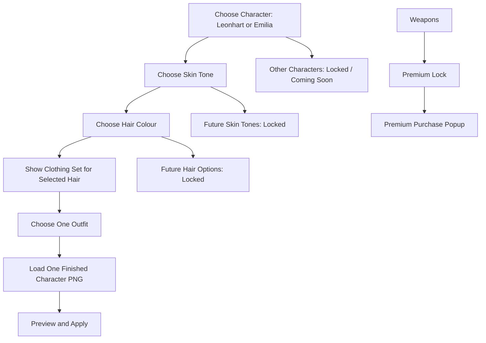

# Day 15 — Character Customization Architecture Redesign & Asset Production

**Project:** System: T-0  
**Date:** 20 November 2026  
**Focus:** Redesigning the character-customization experience, defining the asset hierarchy, and organizing pre-composed character artwork  
**Status:** Architecture direction agreed; asset creation and folder organization in progress; code implementation not started

---

## 1. Executive Summary

Day 15 was a major product and architecture-planning day for the character-customization system.

The earlier implementation direction relied on composing a character at runtime from separate body, face and hair layers. After reviewing the visual alignment problems and the growing number of character/outfit combinations, the direction changed.

The new near-term approach is to use **finished, pre-composed character PNG images** for each supported look. Each finished image contains the character, selected hair colour and outfit together on a consistent canvas. This avoids runtime gaps between separate face and hair layers and makes the selected look easier to preview consistently.

The customization menu will continue to use the label **Face**, but the option represents the character identity, not an individual facial-feature layer. The two initial playable characters are **Leonhart** (male) and **Emilia** (female).

The user created and organized approximately 60 character images across male and female variants. Background removal and final manual file renaming are still pending. No application code was changed and no new customization feature was tested in Expo Go today.

## 2. Product Decisions Confirmed Today

### 2.1 Character identity and gender selection

- The existing profile-name and gender-selection flow remains.
- Male selection continues to show Leonhart by default.
- Female selection continues to show Emilia by default.
- Other gender options continue to display the existing **Coming Soon** state.
- The existing character carousel remains available to switch between the supported character choices where appropriate.
- These existing working profile behaviours should not be broken during the redesign.

### 2.2 Meaning of the Face option

The menu label remains **Face**, but it is now the character-selection category.

Initially, the Face screen will show:
- Leonhart — unlocked.
- Emilia — unlocked.
- Other future characters — locked, visually blurred, with a premium/lock indicator or Coming Soon treatment as designed.

The Face option will not be used to select separate eyes, noses or facial-feature overlays.

### 2.3 Skin-tone selection

The intended character customization hierarchy includes five skin-tone choices:
- Two initially available: **White skin** and **Dark skin**.
- Three additional choices: locked for future release.

Today's artwork work covered the White-skin variants for Leonhart and Emilia. Dark-skin variants for both characters are planned for a later asset-production session.

### 2.4 Hair selection

After choosing the character and skin tone, the user chooses a hair colour. The current artwork set includes multiple variants for each character.

Visible colour families in the supplied asset screenshots include:
- **Leonhart:** Red, Blue, Purple, Blonde and Black, plus the regular/original character reference image.
- **Emilia:** Red/original, Blue, Green-Pink, Pink, Blonde and Black.

Additional future hairstyles can appear as locked options. The exact final number of selectable hair options should be confirmed against the completed asset library.

### 2.5 Clothing selection

Clothing comes after hair selection. The selected character, skin tone and hair colour determine which clothing set is displayed.

The current plan is five clothing looks per hair-colour variant. The supplied folders show five clothing images in the visible sets. The Green-Pink female clothing folder initially appeared to contain four images; the user supplied a follow-up screenshot showing the fifth image, so that set is now accounted for in the screenshot review.

### 2.6 Weapons — premium feature

Weapons are not part of the current image-generation batch and have not yet been created.

The Weapons option is intended to be premium-locked:
1. Show a premium lock indicator on the Weapons option.
2. When the user taps it, open a purchase-premium popup.
3. Do not present it as a currently selectable free customization category.

The premium purchase flow is a product requirement for later implementation; it has not been built or tested.

### 2.7 Apply behaviour

The customization experience should include an **Apply** action for applying a selected category/look. This is not intended to mean a final, irreversible confirmation of the entire character. Restore/reset behaviour should also be considered in the interaction design.

The exact Apply, Cancel and Restore interaction states still need to be specified before implementation.

## 3. Updated Customization User Journey

The agreed high-level order is:

1. User opens the profile and edits their name if desired.
2. User selects gender.
3. The app displays the default character for that gender: Leonhart or Emilia.
4. User opens **Face** and chooses the character identity.
5. User chooses a skin tone.
6. User chooses a hair colour.
7. User chooses a clothing look from the set associated with that hair colour.
8. User applies the selected category/look.
9. Weapons remain premium-locked and open the premium purchase popup when tapped.

The exact placement of character selection and skin-tone selection within the Face screen can be refined during UI implementation, but the overall dependency must remain clear: character and skin tone are selected before the hair and clothing combinations.

## 4. Updated Architecture — Pre-Composed Character Images

### Previous direction

The earlier approach used separate image layers at runtime:

```text
Base character
    ↓
Face layer
    ↓
Hair layer
    ↓
Rendered character
```

This created additional alignment and rendering responsibilities. The team had to verify canvas dimensions, alpha bounds, layer order and crop behaviour for every asset.

### New direction

For the current hair-and-clothing scope, each combination will be exported as one finished character image:

```text
Character + Skin tone + Hair colour + Clothing
                    ↓
          Finished transparent PNG
                    ↓
         App displays one image
```

This removes the need to align separate face and hair layers at runtime for these finished looks. It also makes each thumbnail and full character preview use the same source image.

**Important:** This is the selected near-term approach for the current customization artwork. Future categories such as weapons or additional modular equipment can be evaluated separately rather than assuming every future combination must be manually exported.

## 5. Asset Production Completed / Reviewed Today

The user created approximately 60 images for male and female character variants and organized them into the following existing folders. Folder names are to remain unchanged.

### Character base folders

| Character | Folder |
|---|---|
| Leonhart | `assets/Characters/Male character/Leonhard White skin` |
| Emilia | `assets/Characters/Female character/Emilia White skin` |

The screenshots show a regular/original full-character image in each character folder.

### Hair variant folders

| Character | Folder |
|---|---|
| Leonhart | `assets/Hairs/Male hair/Leonhard hair color varients` |
| Emilia | `assets/Hairs/Female hair/Emilia hair color vareints` |

The current screenshots show the following hair-colour artwork:
- Leonhart: Red, Purple, Blue, Blonde and Black.
- Emilia: Red/original, Blue, Green-Pink, Pink, Blonde and Black.

The folder spellings shown above are preserved as currently named. Folder renaming is not part of today's task.

### Clothing folders

| Character / variant | Folder pattern |
|---|---|
| Leonhart — Black hair | `assets/Clothes/Male/Male_Leonhard_Whiteskin_Black_hair_Clothes` |
| Leonhart — Blue hair | `assets/Clothes/Male/Male_Leonhard_Whiteskin_Blue_hair_Clothes` |
| Leonhart — Blonde hair | `assets/Clothes/Male/Male_Leonhard_Whiteskin_Blonde_hair_Clothes` |
| Leonhart — Purple hair | `assets/Clothes/Male/Male_Leonhard_Whiteskin_Purple_hair_Clothes` |
| Leonhart — Red hair | `assets/Clothes/Male/Male_Leonhard_Whiteskin_Red_hair_Clothes` |
| Emilia — Black hair | `assets/Clothes/Female/Female_Emilia_whiteskin_Black_clothes` |
| Emilia — Blue hair | `assets/Clothes/Female/Female_Emilia_whiteskin_Blue_clothes` |
| Emilia — Blonde hair | `assets/Clothes/Female/Female_Emilia_whiteskin_Blonde_clothes` |
| Emilia — Green-Pink hair | `assets/Clothes/Female/Female_Emilia_whiteskin_Green-Pink_clothes` |
| Emilia — Pink hair | `assets/Clothes/Female/Female_Emilia_whiteskin_Pink_clothes` |
| Emilia — Regular/original | `assets/Clothes/Female/Female_Emilia_whiteskin_regular_clothes` |

The visible clothing folders contain five outfit images per hair-colour set in the reviewed screenshots. The user also supplied a follow-up screenshot confirming the fifth Green-Pink Emilia outfit image.

## 6. File Naming Convention — Agreed Direction

The user will rename image files manually. No automated renaming script was run and no folders were renamed.

The recommended naming structure is:

```text
[Gender]_[Character]_[SkinTone]_[HairColour]_[OutfitName].png
```

Examples:

```text
Male_Leonhart_WhiteSkin_RedHair_IronVanguard.png
Male_Leonhart_WhiteSkin_BlueHair_RoyalSentinel.png
Male_Leonhart_WhiteSkin_BlondeHair_DragonGuard.png
Female_Emilia_WhiteSkin_BlueHair_MoonlightRanger.png
Female_Emilia_WhiteSkin_PinkHair_CrystalMage.png
Female_Emilia_WhiteSkin_GreenPinkHair_EnchantedWarden.png
```

These outfit names are illustrative fantasy-style examples, not confirmed names for the user's actual five outfits. The final names should match the visual design of each outfit.

Recommended rules:
- Keep the folder structure unchanged.
- Rename image files only.
- Use consistent spelling and capitalization.
- Use underscores between fields and avoid spaces.
- Include gender, character, skin tone and hair colour in every filename.
- Give each outfit a unique fantasy/RPG-style name.
- Keep the original file extension (`.png`, `.jpg`, `.jpeg`, or `.webp`) when renaming.
- Ensure filenames are unique within their folder and easy for Cursor/Claude to identify.

## 7. Background Removal and Image Preparation

Many newly generated images currently have a bright green background. The user plans to remove these backgrounds tomorrow.

Before these images are registered in the app:
1. Remove the green background cleanly.
2. Preserve the sword, shield, hair edges and small pixel-art details.
3. Export with transparency.
4. Keep the same canvas dimensions and character positioning across a related set.
5. Check that no green fringe remains around the character.
6. Verify that the output format and dimensions are consistent within each character set.

The screenshots show that some original/reference images have a non-green or white background while many generated variants have a green background. These must be normalized before final app integration.

## 8. Asset Combination Model

For each supported character and skin tone, the asset library groups the finished character images by hair colour and outfit.



A simplified relationship for one character is:

```text
Leonhart
 └── White Skin
      ├── Red Hair
      │    ├── Outfit 1
      │    ├── Outfit 2
      │    ├── Outfit 3
      │    ├── Outfit 4
      │    └── Outfit 5
      ├── Blue Hair
      │    └── Outfit 1–5
      ├── Purple Hair
      │    └── Outfit 1–5
      ├── Blonde Hair
      │    └── Outfit 1–5
      └── Black Hair
           └── Outfit 1–5
```

Emilia follows the same structure, using her own hair colours and clothing artwork.

## 9. Important Scale Consideration

The number of finished images grows as combinations are added. For example, five hair colours with five outfits each already require 25 images for one character/skin-tone set.

The current plan is manageable for the first release scope, but future expansion should be planned carefully:
- Add the second skin tone as a separate asset set.
- Avoid creating every theoretical combination until it is needed.
- Consider scripts or modular rendering for future high-volume combinations, while keeping the current finished-image approach for the first implementation.
- Weapons remain a separate premium feature and are not included in today's image count.

## 10. Issues, Constraints and Decisions

| Issue / constraint | Decision or current status |
|---|---|
| Runtime face/hair layer alignment | Move to one finished image per current look |
| Previous layered-character architecture | No longer the preferred approach for the current customization set |
| Image filenames are timestamp-based | User will rename image files manually using a consistent naming convention |
| Green backgrounds remain on many images | Remove backgrounds in the next asset-preparation session |
| Folder names | Keep existing folder names unchanged |
| Weapons artwork | Not created yet; planned as premium-locked |
| Dark-skin variants | Not created today; planned for both Leonhart and Emilia |
| Locked character/skin/hair choices | Show blur/lock treatment; future content |
| Apply / Restore interaction | Product requirement identified; exact UI states still need specification |
| App code | No code changes today |
| Device testing | No new Expo Go test today |

## 11. What Was Not Done Today

To keep the development record accurate:
- No React Native or JavaScript files were changed.
- No new asset registry or `looks.js` file was created.
- No new customization popup was implemented.
- No weapon images were generated.
- No green backgrounds were removed.
- No image files were renamed by script.
- No final in-app test of the new pre-composed images was performed.

## 12. Next Steps — Day 16

1. Finish removing green backgrounds from the generated character images.
2. Manually rename image files using the agreed unique naming structure; keep folder names unchanged.
3. Verify that each character/hair folder has the expected number of images.
4. Confirm the five outfit names for each hair-colour set.
5. Create a small asset inventory (character, skin tone, hair colour, outfit name, file path and extension).
6. Review the final transparent images before coding.
7. Design the Face → Character → Skin Tone → Hair → Clothes flow in the UI.
8. Implement the pre-composed image lookup with a small, explicit asset registry.
9. Add Apply and Restore behaviour without breaking the existing profile and carousel.
10. Keep Weapons locked and show the premium popup only when the user taps it.
11. Test on the physical iPhone using Expo Go.

## 13. Final Reflection

Day 15 changed the direction of character customization from assembling multiple visual layers at runtime to selecting a complete, ready-to-display character image for each supported look.

The user made substantial progress on the visual asset library, producing approximately 60 male and female character images and arranging them into character, hair-colour and clothing folders. The next session will focus on transparent backgrounds, consistent filenames and a verified asset inventory before any code integration begins.

**Day 15 outcome:** The new asset-first customization architecture and user journey were agreed, the initial White-skin Leonhart and Emilia artwork sets were organized, and the next asset-preparation tasks were defined. Implementation remains pending.
