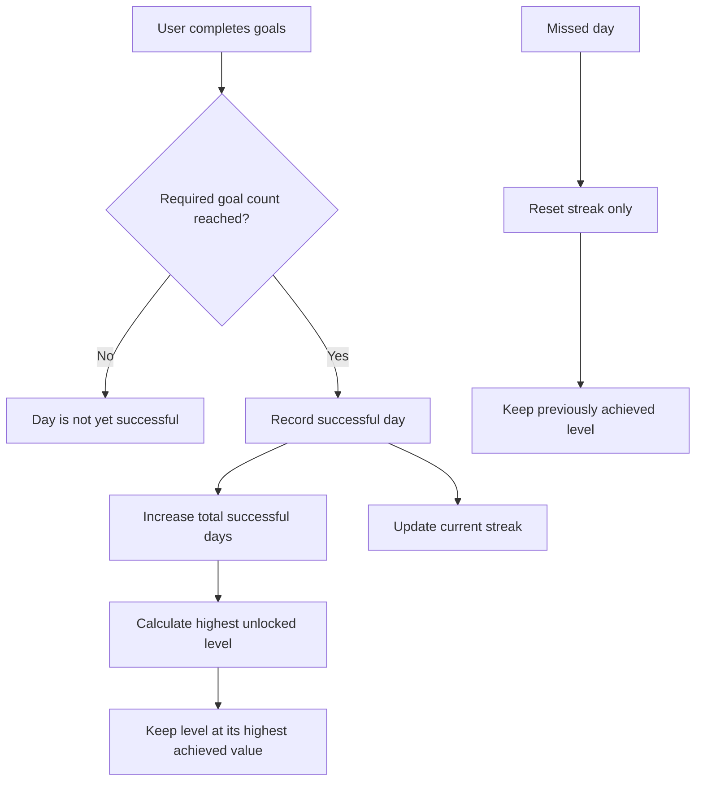
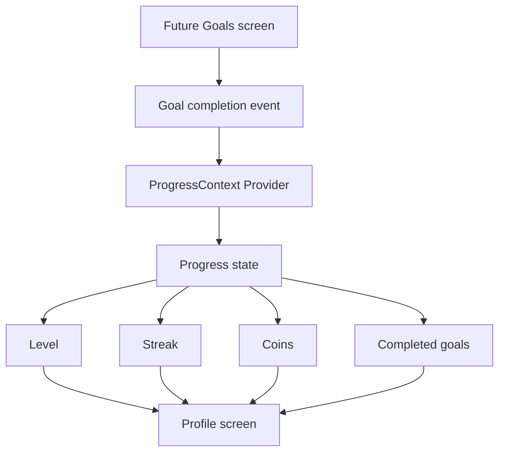
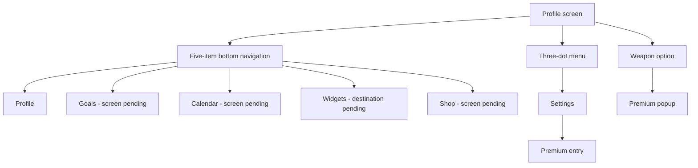
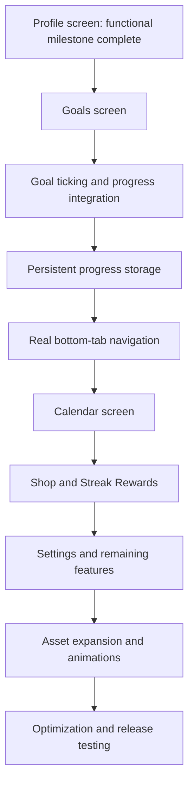

# Day 16 — Character System, Progress Architecture & First Functional Profile UI

**Project:** System: T-0  
**Date:** 20–21 November 2026  
**Focus:** Complete the first functional Profile experience, stabilize character customization, introduce progress-state architecture, and organize Premium access  
**Status:** First functional UI screen completed; next major milestone is the Goals screen

---

## 1. Executive Summary

Day 16 was a major implementation milestone for System: T-0. The work moved beyond the asset and architecture planning of Day 15 and delivered a functional first screen.

The most important architecture decision was to stop composing the current character looks from separate Base, Face and Hair image layers. Small alignment differences created visible gaps, so the app now uses **one complete, pre-composed character image for each look**.

The two initial protagonists are available:
- **Leonhart** — male character, White-skin asset set.
- **Emilia** — female character, White-skin asset set.

The character catalogue connects their available looks, hair variants and clothing options. The Profile customization flow, Premium popup and initial progress-state architecture were implemented. The Premium entry was also moved out of the bottom navigation and into Settings.

**Milestone:** The first functional UI screen is complete. It is not the complete app, and several linked screens and features remain for later milestones.

## 2. Main Outcome — First Functional Screen

The Profile screen now brings together:
- Leonhart and Emilia as the two initial protagonists.
- Character carousel and character customization.
- Face, Hair, Clothes and Weapon categories.
- Profile name and level information.
- Streak, coins and goals counters.
- Health and Stamina display areas.
- Bottom navigation with five entries.
- Settings access and Premium entry within Settings.

The first screen is considered functionally complete for this milestone. Some displayed values and destinations are still placeholders or awaiting their own screens.

## 3. Character Customization — Architecture Decision

### Previous approach: runtime image layering

The earlier design attempted to assemble a character by stacking separate image assets:

```text
Base character
      ↓
Face image
      ↓
Hair image
      ↓
Combined character
```

Although the assets appeared close when inspected individually, the rendered result showed visible gaps and alignment problems. Canvas dimensions and transparent bounds differed between some assets, making a reliable shared alignment difficult.

### Current approach: one complete image per look

The current character system uses a finished image containing the complete character appearance:

```text
Character + Skin tone + Hair + Outfit
                 ↓
       Complete transparent image
                 ↓
        Display as one character
```

This removes the need to align face and hair layers at runtime for the current character looks. It also makes previews more consistent because the app displays the same complete image that represents the selected look.

**Trade-off:** The approach is simpler and visually reliable for the current scope, but the number of image assets increases as more combinations are added. Future expansion should be planned with asset size and catalogue maintenance in mind.

## 4. Character Catalogue and Available Assets

### New file: `assets/characterCatalog.js`

A central catalogue was added to organize the supported character looks and their related options.

Current scope recorded in the implementation summary:
- Leonhart and Emilia.
- White-skin variants available.
- Six hair variants for each character.
- Five clothing looks per hair-colour set.
- Skin options labelled Skin 1–5.

Skin availability:
- **Skin 1:** available/selectable.
- **Skin 2:** Coming Soon.
- **Skins 3–5:** locked as Premium options.

Dark-skin assets and the three additional premium skin-tone asset sets are not complete yet. The UI options should not be mistaken for finished artwork.

### Asset loading

`assets/profileImages.js` was updated to point to the reorganized asset folders. The catalogue is the central place for associating a character with the appropriate complete images and variants.

The previous layer-based files `assets/characterLayers.js` and `src/components/LayeredCharacter.js` are now unused by the current complete-image approach. They should be kept until a later cleanup confirms that no remaining imports depend on them.

## 5. Customization UI and Behaviour

### Customize menu order

The menu order is now:

1. Face
2. Hair
3. Clothes
4. Weapon

The Face category is used for the skin/character appearance selection flow rather than assembling separate facial-feature overlays.

### Picker behaviour

`PartPickerModal.js` was updated with:
- Apply
- Cancel
- Restore
- Preview-on-selection behaviour
- Skin labels: Skin 1–5
- Coming Soon treatment for Skin 2
- Premium lock treatment for Skins 3–5

The intended interaction is that a user can preview an option, then Apply it; Cancel should discard the pending selection, while Restore should return to the default selection.

Customization should stay on the currently displayed character/gender. Opening the picker must not unexpectedly switch the user from Emilia to Leonhart or vice versa.

## 6. Premium Popup and Settings

### New file: `src/components/PremiumPopup.js`

A Premium popup was implemented with:
- Dark/black visual treatment.
- A gold lock illustration built from code rather than an emoji.
- A 7-day free-trial message.
- A “Stay on Free” action.

### New configuration file: `src/config/premium.js`

Premium copy and price values are centralized here. The current offer text and prices are **placeholders**, not final commercial terms and not a live subscription integration.

### New file: `src/screens/SettingsScreen.js`

A simple Settings screen was added with a Premium entry.

### Navigation update

The Premium option was removed from the bottom navigation and placed inside Settings. The bottom navigation now contains exactly five entries:

- Profile
- Goals
- Calendar
- Widgets
- Shop

The three-dot control on the Profile screen opens Settings. The Weapon option opens the Premium popup; the actual premium Weapons feature is not yet implemented.

## 7. Progress and Level System

### New file: `src/progress/progress.js`

The initial level and streak rules were implemented.

| Level | Successful days required (cumulative) |
|---|---:|
| Level 1 | Starting level |
| Level 2 | 2 |
| Level 3 | 4 |
| Level 4 | 8 |
| Level 5 | 16 |

The progression is cumulative, not a requirement to complete each level in one uninterrupted block. The level is based on total successful days and **does not decrease**. If a day is missed, the streak resets, but the achieved level remains.

The existing gold-leaf and purple-star badge represents Level 5. It remains unchanged through Level 5; new badge designs above Level 5 can be introduced later.

A day is currently counted after the required number of goals have been completed. The implementation summary records:

- `REQUIRED_GOALS = 2`

This is an initial default and still needs product confirmation. The actual Goals screen has not been built yet, so the full user journey from ticking goals to updating progress remains incomplete.

### Progress calculation flow



## 8. Shared Progress State

### New file: `src/progress/ProgressContext.js`

A shared progress context was introduced so that progress information can be accessed by the Profile screen and future screens.

### App entry update: `app/index.tsx`

The app entry now wraps the Profile screen with `ProgressProvider`.

The Profile screen reads its displayed progress values from the shared progress store rather than relying on the old hardcoded sample values.

For a new user, the intended initial display is:
- Level 1
- 0 streak
- 0 coins
- 0 completed goals

### State relationship



The context establishes a shared state structure, but persistence has not yet been added. Progress can still be lost when the app closes or reloads.

## 9. Main Profile Navigation

The current navigation plan is represented below. The five bottom-bar entries are visible, but not all destination screens are implemented yet.



**Navigation status:** The bottom bar currently changes a selected-tab state in the Profile implementation; real screen-to-screen navigation still needs to be completed. The Goals, Calendar and Shop screens are not yet built. Streak Rewards should eventually link to Shop, and Calendar should eventually open the Calendar screen once those screens exist.

## 10. Files Added and Updated

### New files

| File | Responsibility |
|---|---|
| `assets/characterCatalog.js` | Catalogues complete character looks and variants |
| `src/config/premium.js` | Centralizes Premium popup copy and placeholder prices |
| `src/components/PremiumPopup.js` | Premium popup UI and lock presentation |
| `src/progress/progress.js` | Level, successful-day and streak rules |
| `src/progress/ProgressContext.js` | Shared progress state |
| `src/screens/SettingsScreen.js` | Settings screen with Premium entry |

### Updated files

| File | Change |
|---|---|
| `src/components/PartPickerModal.js` | Apply, Cancel, Restore and updated skin picker presentation |
| `src/screens/ProfileScreen.js` | Complete-image customization, progress values, Settings access and Premium popup integration |
| `src/components/CustomizeMenu.js` | Menu order: Face, Hair, Clothes, Weapon |
| `src/components/BottomTabBar.js` | Five entries; Premium removed |
| `app/index.tsx` | Wraps Profile with ProgressProvider |
| `assets/profileImages.js` | Updated image references for reorganized asset folders |

This log records the file changes reported during the Day 16 work. The app source itself remains local and is not being uploaded to this documentation repository.

## 11. Technical Issues Faced and How They Were Addressed

| Issue | Why it happened | Resolution / status |
|---|---|---|
| Visible gaps between face and hair layers | Different canvas sizes and transparent bounds made runtime alignment unreliable | Replaced the current layered look approach with complete character images |
| Character changed unexpectedly when opening customization | Picker state and current-character selection were not kept separate | Updated customization behaviour to stay on the currently displayed character |
| Female customization jumped to male | The picker flow was tied to the wrong/default character state | Updated Profile customization so it respects the active character |
| Old asset paths | Files and folders had been renamed or moved | Updated `profileImages.js` and introduced a central character catalogue |
| Setup command run from the wrong directory | Expo was started from inside the assets folder rather than the project root | Run Expo commands from `K:\System T0\system-t-zero` |
| Filename with a double dot | One asset filename contains `..` before its extension | The file was referenced using its actual filename; it can be normalized in a later cleanup |
| Local files unavailable to Claude automatically | Claude could not directly inspect the user's local project | Relevant file listings and code were supplied manually |
| Progress reset after app restart | Persistent storage has not been integrated | Remains a future task; evaluate AsyncStorage or another suitable persistence option |

## 12. Testing and Verification Status

### Confirmed by the user's device testing / Day 16 report
- Character system is working on the iPhone with Expo Go.
- Leonhart and Emilia are available.
- Character customization is functioning with the complete-image approach.
- Premium popup is implemented and working.
- Profile displays progress values from the progress store.
- The user confirmed the Settings screen is now done and Premium has been moved into Settings.

### Logic testing
- The progress rules were tested in Node, according to the implementation handoff.

### Not yet verified or not yet implemented
- Full Goals-to-progress interaction on a real Goals screen.
- Real navigation to Goals, Calendar and Shop screens.
- Progress persistence after closing/reopening the app.
- Final Premium prices and real subscription/purchase integration.
- The Weapons feature itself.
- Dark-skin and premium skin artwork.
- Dynamic Health and Stamina values.
- Release-build size and final performance.

Do not interpret the presence of a tab or placeholder as proof that its destination feature is complete.

## 13. Remaining Work

### Immediate next milestone — Goals screen
1. Review the user's raw Goals-screen diagram and animation reference.
2. Build the basic Goals screen.
3. Allow users to add goals.
4. Allow goals to be ticked and unticked.
5. Show the number of goals completed today.
6. Connect goal completion to `onGoalTicked` from `progress.js`.
7. Test how successful days update level and streak.

### Navigation and storage
- Implement real screen navigation for the five bottom-bar entries.
- Build Calendar and Shop screens before connecting their destinations.
- Connect Streak Rewards to Shop when Shop exists.
- Add persistent storage for progress.
- Decide the coin reward rule for goal completion.

### Later product and asset work
- Create dark-skin variants for Leonhart and Emilia.
- Create the three premium skin asset sets.
- Decide whether the Knight title remains on the Profile name card.
- Replace placeholder Premium copy and prices with confirmed terms.
- Implement the actual Weapons premium feature.
- Replace hardcoded Health and Stamina values with real state.
- Review and remove unused layer-based files only after checking imports.
- Optimize image assets and measure the actual release build size.

## 14. Recommended Development Sequence



The next screen should be the Goals screen. Build one screen at a time: first make its basic layout and behaviour work, then refine its visual design and animation. This avoids building several unfinished screens at once.

## 15. Day 16 Reflection

Day 16 marks the first major functional UI milestone for System: T-0. The work involved changing the character-rendering architecture, organizing the character catalogue, correcting customization behaviour, introducing a shared progress model, building the Premium popup and Settings entry, and reducing the bottom navigation to five options.

The journey included visual alignment problems, broken asset paths, navigation-state issues and limitations in how AI tools could access local files. These were handled through a simpler complete-image architecture, focused code updates and manually sharing the necessary project information.

The first screen is not the whole app, but it is now a working foundation with the two main protagonists, customization, profile information and a defined progress structure.

**Day 16 outcome:** The first functional Profile UI milestone is complete. The next major milestone is the Goals screen.

**Development principle going forward:** Work one feature at a time, inspect existing code before editing, preserve working functionality, and verify changes on the iPhone before marking them complete.
