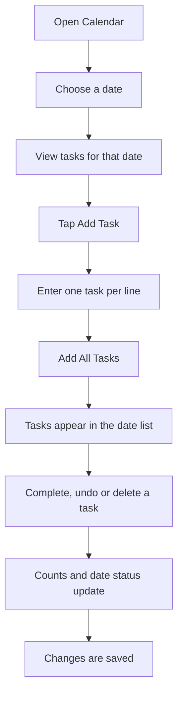

# Day 17 — Calendar Screen Completion

**Project:** System: T-0  
**Date:** 22 November 2026  
**Focus:** Calendar implementation, task management, persistence, navigation and device testing  
**Status:** Calendar screen completed and confirmed working by the user on iPhone through Expo Go

## Summary

Day 17 began with the user's rough Calendar sketch and a discussion of how daily tasks should work. The sketch was translated into a functional Calendar screen, then refined through several focused implementation and testing rounds.

The Calendar now supports month navigation, date selection, bulk task entry, task completion, individual deletion, sorting, clearing a day's list, saved task data, history status colours and a Today shortcut. The user tested the completed screen on an iPhone and reported that it works smoothly.

## What Was Built

| Area | Result |
|---|---|
| Calendar grid | Real month/year, Monday-first layout, previous/next month navigation and selected-date state |
| Task entry | Multiline input; one task per line; add multiple tasks in one submission |
| Task management | Tick/untick, completed and remaining counts, strikethrough and individual delete |
| List controls | Three-dot menu, Added Order / A–Z sorting and Clear All with confirmation |
| Persistence | AsyncStorage integration so tasks and completion states survive app restarts |
| Date indicators | Purple task dots; green completed-day state; red incomplete past-day state; selected-date ring |
| Past/future rules | Recent past dates remain editable within the four-day window; older dates are view-only; future dates remain neutral |
| Navigation | Calendar opens as its own screen; Goals, Widgets and Shop use separate placeholder destinations |
| Visual design | Refined minimal lavender UI, lighter typography, compact task rows and simpler month controls |

## User Flow

## Local Application Files

The following local project files were created or updated during the Calendar work. The application source remains in the user's local project and is not stored in this documentation repository.

| File | Work |
|---|---|
| `src/screens/CalendarScreen.js` | Built and refined the Calendar UI, date logic, task modal, sorting, clear confirmation, status colours and Today shortcut |
| `src/goals/GoalsContext.js` | Added shared task operations for bulk adding and clearing tasks for one date; retained individual add, toggle and remove behaviour |
| `src/screens/AppShell.js` | Connected the bottom navigation to the correct screen destinations |
| `src/screens/PlaceholderScreen.js` | Added reusable Coming Soon destinations for unfinished tabs |
| `app/index.tsx` | Left unchanged during the Calendar navigation update |
| `src/screens/ProfileScreen.js` | Left unchanged; Profile behaviour was regression-checked |

**Dependency:** `@react-native-async-storage/async-storage` was installed with `npx expo install` for task persistence. No new package was needed for the Calendar menu or bulk-entry UI.

## Issues and Decisions

| Issue / requirement | Resolution |
|---|---|
| Adding tasks one at a time was slow | Replaced the single-task flow with a multiline, one-task-per-line entry and one Add All action |
| Users needed to manage long lists | Added Added Order and A–Z sorting, plus Clear All with a date-specific confirmation |
| Tasks disappeared after reload in the earlier in-memory version | Added AsyncStorage persistence; the user tested task retention after app restart |
| Calendar dates needed a quick visual history | Added task dots, completed/incomplete day colours and a selected-date ring |
| Returning from another month was inconvenient | Added a Today shortcut |
| Bottom tabs previously led to the same Profile destination | Added separate destinations; unfinished tabs display Coming Soon placeholders |
| Initial Calendar styling felt too heavy / generic | Refined typography, card treatment, month controls and task rows while retaining the lavender visual identity |
| Expo's floating blue developer-tools control overlapped the UI | Identified as a development overlay rather than an app component; left outside application-code changes |

## Verification

The user tested the Calendar on a physical iPhone using Expo Go and confirmed that the screen works smoothly.

Verified interactions reported by the user:
- Adding multiple tasks and displaying completed / remaining counts.
- Completing and uncompleting tasks, with the count and strikethrough updating.
- Removing individual tasks.
- Adding tasks to recent past dates and using the four-day editing window.
- Calendar date navigation and task-list behaviour.

The final Step 5 update added the history colours, task dots and Today shortcut. The user confirmed the Calendar as complete after testing.

## Day 17 Outcome

**The Calendar screen is complete for the current scope.** It now provides a practical daily planning workflow with bulk entry, task controls, date-based history, persistence and a refined interface. Profile was preserved, and unfinished navigation destinations remain clearly marked as placeholders.

## Next Development Direction

Do not add more Calendar features without a clear user need. The next planning decision is whether to complete the remaining core screens first or begin the shared progression loop (XP, coins and levels). Prefer completing the essential screen flows and connecting them reliably before adding optional game systems.

**Development principle:** keep changes focused, preserve working screens, and mark a feature complete only after testing it on the iPhone.
